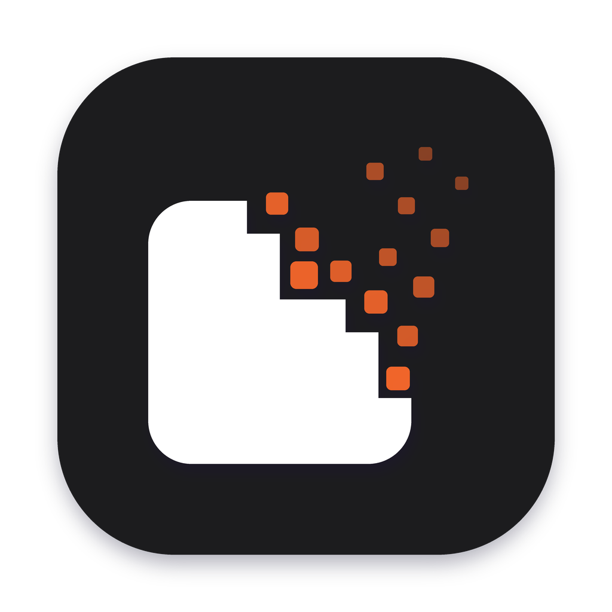
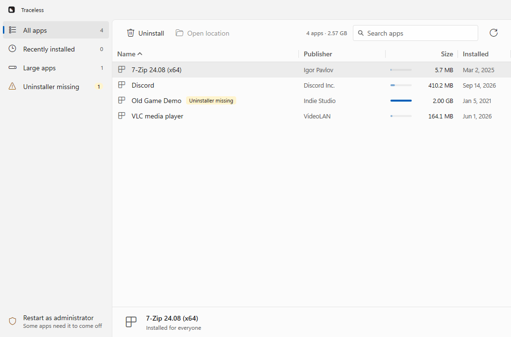
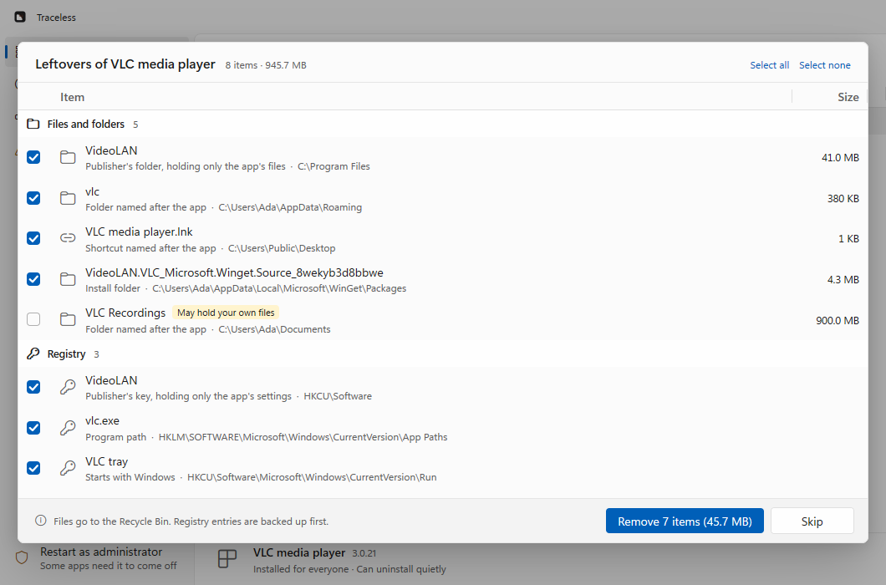

<p align="center">
  
</p>

<h1 align="center">Traceless</h1>

<p align="center">
  <b>Uninstall Windows apps — and everything they leave behind.</b><br>
  A small, fast, native Windows 11 app. No webview, no runtime, one 10 MB exe.
</p>

<p align="center">
  <a href="https://github.com/Prit36/traceless/releases/latest"></a>
  
  <a href="LICENSE"></a>
</p>

<p align="center">
  
</p>

Most uninstallers leave folders in AppData, keys in the registry, shortcuts and
startup entries behind. Traceless runs the app's own uninstaller, then finds what's
left and lets you remove it safely.

## Features

- **Every installed app in one list.** Search, sort by name, publisher, size or date,
  and filter to the recently installed, the large ones, or those whose uninstaller is missing.
  Size shows as a bar, so the biggest stand out.
- **Runs the real uninstaller** — quietly when the app supports it — and waits for it
  *and every process it starts*, so the leftover scan never races the uninstaller.
- **Finds the leftovers:** folders and files in Program Files, ProgramData and AppData,
  Start menu and desktop shortcuts, and registry keys and values (settings, startup entries,
  App Paths, file associations, Explorer's caches).
- **Careful by default.** Sure matches are pre-selected; possible matches (shared names,
  other versions, folders that may hold your own files) are flagged and left unticked.
  Windows, Microsoft and your personal folders are never touched.
- **Undoable.** Files go to the **Recycle Bin**; registry entries are exported to `.reg`
  backups first (`%LOCALAPPDATA%\Traceless\Registry backups`).
- **Cleans up broken entries** whose uninstaller is gone — including the stale entry itself.
- **Feels native:** Mica, Fluent icons, your accent color, light and dark themes.

<p align="center">
  
</p>

## Install

Download from [Releases](https://github.com/Prit36/traceless/releases/latest):

- `traceless-setup-<version>-amd64.exe` — installer, or
- `Traceless-<version>-portable-amd64.zip` — unzip and run `Traceless.exe`.

Traceless asks for administrator rights when it starts, which apps installed for
everyone need. Decline and it runs as is; the side pane offers to restart as administrator.

> The builds aren't code-signed yet, so Windows SmartScreen may warn on first run:
> choose **More info → Run anyway**.

## Build from source

Requires [Go](https://go.dev/dl/) 1.27+ on Windows. Traceless is built with
[MyGo](https://github.com/egoist/mygo)'s native UI, drawn on the GPU.

```sh
go tool mygo dev      # run with live reload (set TRACELESS_NO_ELEVATE=1 to skip UAC)
go test ./...         # scanner, cleanup and UI-flow tests (headless)
go tool mygo build    # build/windows-amd64: Traceless.exe and an installer
```

## License

[MIT](LICENSE)
